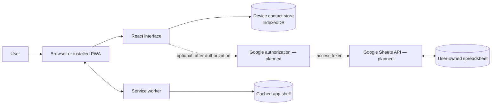
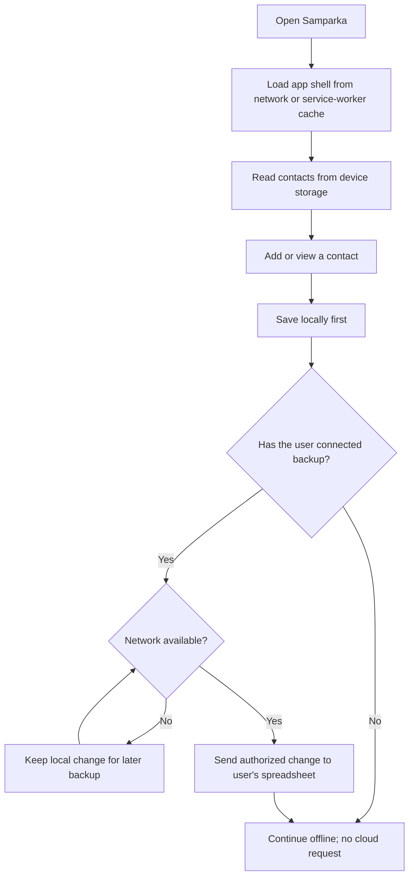

# Samparka

**Samparka is a local-first contact app in development.** Its direction is an installable PWA for keeping contact details and useful context on the user's device. Optional backup to a spreadsheet in the user's own Google account is a future direction; it is not implemented.

This checkout contains the React, TypeScript, and Vite foundation, PWA setup, typed contact model with a local IndexedDB repository, and mobile-first contact app shell. The current list and add-contact form are placeholders; functional contact CRUD is tracked in Issue #4, and search, sorting, and tag filtering are tracked in Issue #5. Google sign-in and backup are not implemented.

## Project status

| Area | Status |
| --- | --- |
| React, TypeScript, Vite, Tailwind, and PWA foundation (Issue #1) | In place |
| Typed contact model and IndexedDB repository (Issue #2) | In place |
| Mobile-first app shell and navigation (Issue #3) | In place |
| Contact list, detail, and manual CRUD (Issue #4) | In progress; see the open issue and its pull request |
| Local search, sorting, and tag filtering (Issue #5) | Planned |
| Google sign-in, spreadsheet backup/restore, and synchronization | Future work; not configured |
| Encryption, conflict handling, and AI-generated tag suggestions | Future decisions; not implemented |

## Product principles

- **Local by default:** Contact data should live in the user's browser. No account or cloud service should be required for everyday use.
- **Works without a connection:** The app shell should load offline after it has been cached. The contact repository reads and writes browser-local IndexedDB without a network connection.
- **Optional backup:** A future Google Sheets integration should only run after the user explicitly connects it. The spreadsheet would belong to the user's Google account.
- **Portable data:** Export and restore options are future work and should let people keep control of their information.
- **Small client-only foundation:** The initial product is intended to run as a static web app without a Samparka-operated backend.

## Architecture direction

The diagram shows the intended product architecture and planned integrations. The PWA setup, mobile-first app shell, and contact store exist in this checkout. Functional contact management and organization are being delivered through Issues #4 and #5; optional Google backup is future work.



The service worker is configured to precache the production app shell and use the app page as a navigation fallback. Runtime API caching is disabled. In particular, the current service worker does not cache contact data or API responses.

## Intended contact and backup flow

This flow describes the intended behavior after contact CRUD and optional backup are built. The current checkout has the app shell and placeholder contact views, but not a saved-contact workflow or backup.



The backup flow still needs design and implementation. It will need explicit authorization, a way to select or create the backup spreadsheet, and clear handling for network errors, token expiry, duplicate records, and edits made on more than one device.

## Contact model and local storage

The repository stores contacts locally in a versioned IndexedDB database named `samparka`. The `contacts` object store is accessed through the `ContactRepository` interface in `src/contacts/contactRepository.ts`; UI code should use that boundary rather than opening IndexedDB directly. The repository has no network or AI-provider dependency, so reads and writes work offline. In this checkout, the repository is implemented, but the placeholder UI does not yet save or load contacts through it.

The typed model in `src/contacts/contact.ts` is:

```ts
interface Contact {
  id: string
  name: string
  phoneNumbers: string[]
  emails: string[]
  description?: string
  tags: string[]
  createdAt: number
  updatedAt: number
}
```

Names and phone numbers are required and trimmed; phone numbers remain strings so formatting and leading zeros are retained. Email addresses are optional and validated when present. Empty optional values become empty arrays or an omitted description. Tags are trimmed, blank values removed, and case-insensitive duplicates collapsed while retaining the first display spelling. Each contact receives a UUID and Unix epoch millisecond timestamps. Updates preserve the ID and creation time and advance the update time. Database schema changes should increment the IndexedDB version and add upgrade steps in the repository's `openDB` callback.

## Run the project

### Prerequisites

- Node.js 20.19+ or 22.12+
- npm 10+

### Install and start the development server

```sh
npm install
npm run dev
```

Open the local address printed by Vite.

### Build and preview

```sh
npm run build
npm run preview
```

The production output is written to `dist/`.

### Checks and formatting

```sh
npm run test
npm run lint
npm run format:check
```

Run `npm run format` to apply Prettier formatting. The smoke test uses Vitest and React Testing Library.

## PWA and offline behavior

The production build includes a web app manifest, PNG and SVG placeholder icons, and a Workbox service worker. The service worker precaches the generated app shell and falls back to `index.html` for navigation requests. It has no runtime API caching rules.

A deployed PWA needs a secure context, normally HTTPS. `localhost` is treated as secure for local development. Offline support in this checkout covers the app shell and the repository can read/write IndexedDB without a network connection. The placeholder contact views do not yet use the repository, and the service worker does not cache contact data. Placeholder typography loads from Google Fonts when a network connection is available and falls back to local system fonts otherwise.

## Deployment direction

The project is a static Vite app and can be hosted on a static HTTPS host such as GitHub Pages. A deployment workflow and GitHub Pages base-path configuration have not been added yet. Before publishing from a repository subpath, configure Vite's `base` value to match that path and add a deployment workflow. Verify the published manifest, icon URLs, service-worker scope, installation prompt, and app-shell loading while offline.

## Privacy and security direction

- The current UI has the contact app shell and placeholder views, but no working contact-management flow, sign-in, or synchronization. The contact model and local storage repository are implemented; the UI does not yet save contacts through them.
- Clearing browser storage or changing devices can remove the only local copy. An export or backup path should be available before relying on the app for important information.
- Any future Google integration should request only the access it needs and explain what information will be written to the selected spreadsheet. OAuth client identifiers are not private secrets; private keys and service-account credentials must never be shipped in frontend code.
- Data in a Google spreadsheet would follow that spreadsheet's sharing and account settings. A client-only app does not make a shared spreadsheet private.
- Encryption and multi-device conflict resolution are not implemented. Their requirements should be decided before backup is treated as a reliable sync system.

## Current feature sequence

The first five issues establish the app foundation and core contact workflow:

1. [Issue #1](https://github.com/Pujith-M/Samparka/issues/1) — initialize the React/TypeScript PWA foundation. Completed.
2. [Issue #2](https://github.com/Pujith-M/Samparka/issues/2) — define the contact model and IndexedDB repository. Completed.
3. [Issue #3](https://github.com/Pujith-M/Samparka/issues/3) — build the mobile-first app shell and navigation. Completed and present in this checkout.
4. [Issue #4](https://github.com/Pujith-M/Samparka/issues/4) — implement the contact list, detail view, and manual create/read/update/delete workflow. In progress.
5. [Issue #5](https://github.com/Pujith-M/Samparka/issues/5) — add local search across name, phone numbers, email addresses, description, and tags; sorting by name or most recently updated; and tag filtering. Planned.

After these, decide and document export/restore and optional spreadsheet backup requirements before implementing authorization, backup, or cross-device synchronization. Keep encryption, conflict handling, and AI-generated tag suggestions as separate future decisions. Tags themselves are part of the contact model and are user-editable; AI tag generation is not implemented.

## Technology

- React and TypeScript for the interface
- Vite for local development and production builds
- Tailwind CSS for styling utilities and design tokens
- `vite-plugin-pwa` and Workbox for the manifest and app-shell service worker
- Vitest, jsdom, and React Testing Library for component checks
- ESLint and Prettier for code quality and formatting

The dependency versions are recorded in `package-lock.json`; use `npm install` to install the locked project dependencies. TypeScript is on 6.0.3, the newest release supported by the current `typescript-eslint` release. TypeScript 7 is newer, but that linter currently rejects it.
