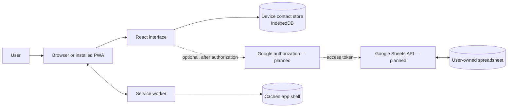
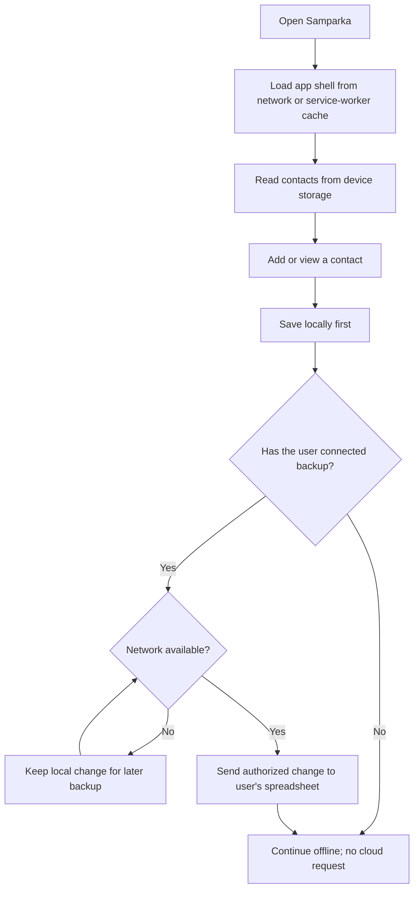

# Samparka

**Samparka is planned as a private, offline-first place to keep contact details and the small things worth remembering about people.** The long-term direction is an installable web app that stores its data on the user's device and can optionally back it up to a spreadsheet in the user's own Google account.

This repository contains a responsive React and TypeScript placeholder screen, a Vite build, PWA manifest and service worker setup, and a typed contact model with a local IndexedDB repository. Contact screens, Google sign-in, and backup are not implemented yet.

## Project status

| Area                                             | Status                      |
| ------------------------------------------------ | --------------------------- |
| React, TypeScript, and Vite foundation           | In place                    |
| Responsive Samparka placeholder screen           | In place                    |
| Tailwind CSS integration                         | In place                    |
| Web app manifest, icons, and service worker      | Configured                  |
| App-shell precache and navigation fallback       | Configured                  |
| Contact screens and CRUD                         | Planned                     |
| Typed contact model and IndexedDB repository     | In place                    |
| Google Sheets authorization, backup, and restore | Future work; not configured |
| Encryption, conflict handling, and AI features   | Longer-term ideas           |

## Product principles

- **Local by default:** Contact data should live in the user's browser. No account or cloud service should be required for everyday use.
- **Works without a connection:** The app shell should load offline after it has been cached. The contact repository reads and writes browser-local IndexedDB without a network connection.
- **Optional backup:** A future Google Sheets integration should only run after the user explicitly connects it. The spreadsheet would belong to the user's Google account.
- **Portable data:** Export and restore options should let people keep control of their information.
- **Small client-only foundation:** The initial product is intended to run as a static web app without a Samparka-operated backend.

## Architecture direction

The diagram shows the current product architecture and planned integrations. The app shell, service-worker setup, and contact store exist in this repository; optional Google backup is planned.



The service worker is configured to precache the production app shell and use the app page as a navigation fallback. Runtime API caching is disabled. In particular, the current service worker does not cache contact data or API responses.

## Intended contact and backup flow

This flow describes the planned behavior once local contacts and optional backup have been built. It is not a description of functionality available in the current placeholder.



The backup flow still needs design and implementation. It will need explicit authorization, a way to select or create the backup spreadsheet, and clear handling for network errors, token expiry, duplicate records, and edits made on more than one device.

## Contact model and local storage

Contacts are stored locally in a versioned IndexedDB database named `samparka`. The `contacts` object store is accessed through the `ContactRepository` interface in `src/contacts/contactRepository.ts`; UI code should use that boundary rather than opening IndexedDB directly. The repository has no network or AI-provider dependency, so reads and writes work offline.

The typed model in `src/contacts/contact.ts` is:

```ts
interface Contact {
  id: string
  name: string
  phoneNumbers: string[]
  emails: string[]
  description?: string
  tags: string[]
  createdAt: number
  updatedAt: number
}
```

Names and phone numbers are required and trimmed; phone numbers remain strings so formatting and leading zeros are retained. Email addresses are optional and validated when present. Empty optional values become empty arrays or an omitted description. Tags are trimmed, blank values removed, and case-insensitive duplicates collapsed while retaining the first display spelling. Each contact receives a UUID and Unix epoch millisecond timestamps. Updates preserve the ID and creation time and advance the update time. Database schema changes should increment the IndexedDB version and add upgrade steps in the repository's `openDB` callback.

## Run the project

### Prerequisites

- Node.js 20.19+ or 22.12+
- npm 10+

### Install and start the development server

```sh
npm install
npm run dev
```

Open the local address printed by Vite.

### Build and preview

```sh
npm run build
npm run preview
```

The production output is written to `dist/`.

### Checks and formatting

```sh
npm run test
npm run lint
npm run format:check
```

Run `npm run format` to apply Prettier formatting. The smoke test uses Vitest and React Testing Library.

## PWA and offline behavior

The production build includes a web app manifest, PNG and SVG placeholder icons, and a Workbox service worker. The service worker precaches the generated app shell and falls back to `index.html` for navigation requests. It has no runtime API caching rules.

A deployed PWA needs a secure context, normally HTTPS. `localhost` is treated as secure for local development. The current offline support covers the app shell; it does not imply offline contact management because contact storage and contact screens have not been implemented. Placeholder typography loads from Google Fonts when a network connection is available and falls back to local system fonts otherwise.

## Deployment direction

The project is a static Vite app and can be hosted on a static HTTPS host such as GitHub Pages. A deployment workflow and GitHub Pages base-path configuration have not been added yet. Before publishing from a repository subpath, configure Vite's `base` value to match that path and add a deployment workflow. Verify the published manifest, icon URLs, service-worker scope, installation prompt, and app-shell loading while offline.

## Privacy and security direction

- The current placeholder has no contact data, sign-in, or synchronization.
- When local contact storage is added, clearing browser storage or changing devices can remove the only copy. An export or backup path should be available before relying on the app for important information.
- Any future Google integration should request only the access it needs and explain what information will be written to the selected spreadsheet. OAuth client identifiers are not private secrets; private keys and service-account credentials must never be shipped in frontend code.
- Data in a Google spreadsheet would follow that spreadsheet's sharing and account settings. A client-only app does not make a shared spreadsheet private.
- Encryption and multi-device conflict resolution are not implemented. Their requirements should be decided before backup is treated as a reliable sync system.

## Roadmap

1. **Contact basics:** Build contact list and detail views, create/edit/delete interactions, and accessible responsive forms.
2. **Local persistence:** Add IndexedDB storage, migrations, and a clear export/restore format.
3. **Backup design:** Decide how users select a spreadsheet, authorize access, and restore data; document failure and conflict behavior.
4. **Optional Google Sheets backup:** Implement the agreed backup flow without placing private credentials in the client.
5. **Reliability and privacy:** Add sync status, retry behavior, conflict choices, and evaluate whether encrypted backups are needed.
6. **Explore later ideas:** Consider tags, duplicate suggestions, and other features only after the core data flows are dependable.

## Technology

- React and TypeScript for the interface
- Vite for local development and production builds
- Tailwind CSS for styling utilities and design tokens
- `vite-plugin-pwa` and Workbox for the manifest and app-shell service worker
- Vitest, jsdom, and React Testing Library for component checks
- ESLint and Prettier for code quality and formatting

The dependency versions are recorded in `package-lock.json`; use `npm install` to install the locked project dependencies. TypeScript is on 6.0.3, the newest release supported by the current `typescript-eslint` release. TypeScript 7 is newer, but that linter currently rejects it.
