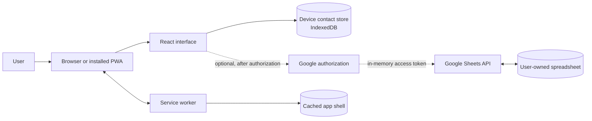
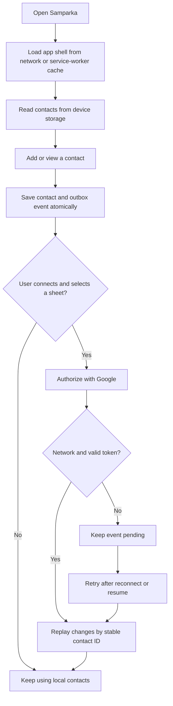

# Samparka

**Samparka is a local-first contact app in development.** It is an installable PWA for keeping contact details and useful context on the user's device. Contacts are saved locally first. An opt-in Google Sheets flow can import contacts and manually back up queued local changes to a selected spreadsheet.

This checkout contains the React, TypeScript, and Vite foundation, PWA setup, typed contact model, local IndexedDB repository, contact CRUD, local search/filter/sort, and an opt-in Google Sheets connector with a durable local outbox. Google access requires Cloud configuration and a real-account smoke check. The sync flow is still in development.

## Project status

| Area                                                             | Status                                                                          |
| ---------------------------------------------------------------- | ------------------------------------------------------------------------------- |
| React, TypeScript, Vite, Tailwind, and PWA foundation (Issue #1) | In place                                                                        |
| Typed contact model and IndexedDB repository (Issue #2)          | In place                                                                        |
| Mobile-first app shell and navigation (Issue #3)                 | In place                                                                        |
| Contact list, detail, and manual CRUD (Issue #4)                 | Implemented                                                                     |
| Local search, sorting, and tag filtering (Issue #5)              | Implemented                                                                     |
| Google Sheets import and queued backup                           | In progress; requires Google Cloud configuration and a real-account smoke check |
| Multi-device synchronization and automatic background execution  | Not implemented                                                                 |
| Encryption, conflict handling, and AI-generated tag suggestions  | Future decisions; not implemented                                               |

## Product principles

- **Local by default:** Contact data should live in the user's browser. No account or cloud service should be required for everyday use.
- **Works without a connection:** The app shell should load offline after it has been cached. The contact repository reads and writes browser-local IndexedDB without a network connection.
- **Optional backup:** Google Sheets access runs only after the user explicitly authorizes and selects a spreadsheet. The spreadsheet belongs to the user's Google account.
- **Portable data:** Export and restore options are future work and should let people keep control of their information.
- **Small client-only foundation:** The initial product is intended to run as a static web app without a Samparka-operated backend.

## Architecture direction

The diagram shows the current local-first architecture and the optional Sheets consumer. The local repository and outbox are durable in IndexedDB; the Google consumer uses them only after user authorization.



The service worker is configured to precache the production app shell and use the app page as a navigation fallback. Runtime API caching is disabled. In particular, the current service worker does not cache contact data or API responses.

## Intended contact and backup flow

Contacts are saved locally first. A user can explicitly import remote-only rows or back up queued local changes to the selected sheet.



The outbox survives reloads. The browser consumer runs after authorization, on reconnect/resume while the token is still valid, and from the explicit backup action. It does not run while the app is closed. Local records win when an imported stable ID already exists; remote-only contacts are imported without overwriting local records.

The Google Sheets screen supports authorization and selection, explicit import, and queued one-way backup. It keeps the token in memory and stores only the selected sheet ID/name/worksheet locally. See [Google Sheets setup](docs/google-sheets-setup.md) and the [authorization ADR](docs/adr/0001-google-sheets-browser-authorization.md). Complete the real-account smoke check before relying on live Google access.

The [privacy policy](public/privacy.html) describes browser storage, Google access, and disconnect behavior. The [release checklist](docs/release-checklist.md) tracks the remaining public-beta checks.

## Contact model and local storage

The repository stores contacts and the durable change outbox locally in a versioned IndexedDB database named `samparka`. The stores are accessed through the `ContactRepository` interface in `src/contacts/contactRepository.ts`; UI code should use that boundary rather than opening IndexedDB directly. Contact changes and their outbox events commit in one transaction. Sync uses Web Locks where available and a renewable IndexedDB lease otherwise, so stale leases expire after a crashed tab. The repository has no network or AI-provider dependency, so reads and writes work offline.

The typed model in `src/contacts/contact.ts` is:

```ts
interface Contact {
  id: string
  name: string
  phoneNumbers: string[]
  emails: string[]
  description?: string
  tags: string[]
  createdAt: number
  updatedAt: number
}
```

Names and phone numbers are required and trimmed; phone numbers remain strings so formatting and leading zeros are retained. Email addresses are optional and validated when present. Empty optional values become empty arrays or an omitted description. Tags are trimmed, blank values removed, and case-insensitive duplicates collapsed while retaining the first display spelling. Each contact receives a UUID and Unix epoch millisecond timestamps. Updates preserve the ID and creation time and advance the update time. Database schema changes should increment the IndexedDB version and add upgrade steps in the repository's `openDB` callback.

## Run the project

### Prerequisites

- Node.js 20.19+ or 22.12+
- npm 10+

### Install and start the development server

```sh
npm install
npm run dev
```

Open the local address printed by Vite.

### Build and preview

```sh
npm run build
npm run preview
```

The production output is written to `dist/`.

### Checks and formatting

```sh
npm run test
npm run lint
npm run format:check
```

Run `npm run format` to apply Prettier formatting. The smoke test uses Vitest and React Testing Library.

## PWA and offline behavior

The production build includes a web app manifest, PNG and SVG placeholder icons, and a Workbox service worker. The service worker precaches the generated app shell and falls back to `index.html` for navigation requests. It has no runtime API caching rules.

A deployed PWA needs a secure context, normally HTTPS. `localhost` is treated as secure for local development. The app shell and IndexedDB contact/outbox data work offline; the service worker caches the app shell, not the contact data. Google backup requires connectivity and an authorized in-memory token.

## Deployment direction

The project is a static Vite app deployed to GitHub Pages. Local development uses `/`; production builds use the repository base path `/Samparka/`. The GitHub Actions workflow builds and verifies the Pages artifact on pull requests and deploys only from `main`.

## Privacy and security direction

- Contacts and queued operations are stored in browser IndexedDB. Clearing browser storage or changing devices can remove the only local copy; export/restore is not implemented.
- Google access uses a short-lived token held in memory. The OAuth client ID, API key, and project number are public browser configuration; private keys and service-account credentials must never be shipped in frontend code.
- Data in a Google spreadsheet would follow that spreadsheet's sharing and account settings. A client-only app does not make a shared spreadsheet private.
- Encryption and multi-device conflict resolution are not implemented. Their requirements should be decided before backup is treated as a reliable sync system.

## Current feature sequence

The first five issues establish the app foundation and core contact workflow:

1. [Issue #1](https://github.com/Pujith-M/Samparka/issues/1) — initialize the React/TypeScript PWA foundation. Completed.
2. [Issue #2](https://github.com/Pujith-M/Samparka/issues/2) — define the contact model and IndexedDB repository. Completed.
3. [Issue #3](https://github.com/Pujith-M/Samparka/issues/3) — build the mobile-first app shell and navigation. Completed and present in this checkout.
4. [Issue #4](https://github.com/Pujith-M/Samparka/issues/4) — implement the contact list, detail view, and manual create/read/update/delete workflow. Completed.
5. [Issue #5](https://github.com/Pujith-M/Samparka/issues/5) — add local search across name, phone numbers, email addresses, description, and tags; sorting by name or most recently updated; and tag filtering. Completed.

The next work is completing initial sync recovery, safe archive/restore flows, and beta readiness for the optional Google connector. Export/restore, multi-device conflict handling, and AI-generated tag suggestions remain future decisions. Tags are user-editable; AI tag generation is not implemented.

## Technology

- React and TypeScript for the interface
- Vite for local development and production builds
- Tailwind CSS for styling utilities and design tokens
- `vite-plugin-pwa` and Workbox for the manifest and app-shell service worker
- Vitest, jsdom, and React Testing Library for component checks
- ESLint and Prettier for code quality and formatting

The dependency versions are recorded in `package-lock.json`; use `npm install` to install the locked project dependencies. TypeScript is on 6.0.3, the newest release supported by the current `typescript-eslint` release. TypeScript 7 is newer, but that linter currently rejects it.

## GitHub Pages deployment

The production site is published at https://pujith-m.github.io/Samparka/.

- The app is built with Vite using the repository-site base path `/Samparka/`. Do not change this to `/` unless the repository becomes a user/organization Pages site or uses a custom domain at the root.
- `.github/workflows/deploy-pages.yml` runs lint, tests, a production build, and output-path smoke checks on pull requests and pushes to `main`.
- Only a successful push or manual run on `main` can deploy. Pull requests are build-only and never publish.
- The deployment job uses the verified build artifact from the build job and the official GitHub Pages actions.
- To enable publishing, open **Settings → Pages → Build and deployment → Source** and choose **GitHub Actions**.

The workflow deliberately fails before deployment if the Vite output, PWA manifest, service worker, or repository asset prefix is missing. Keep the Pages base path, manifest start URL, manifest scope, and icon URLs aligned with the repository URL.
